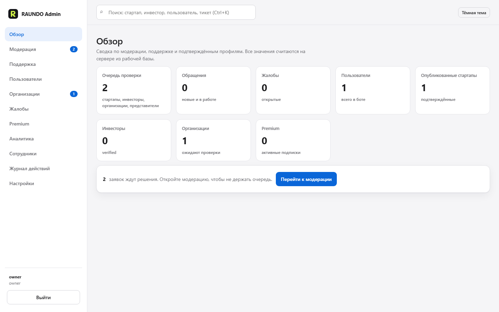
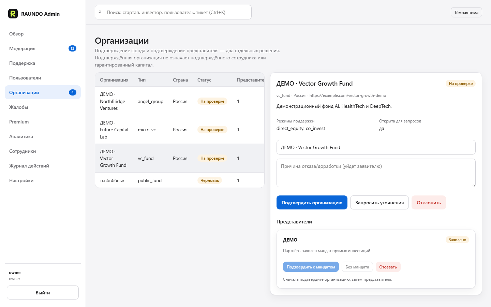
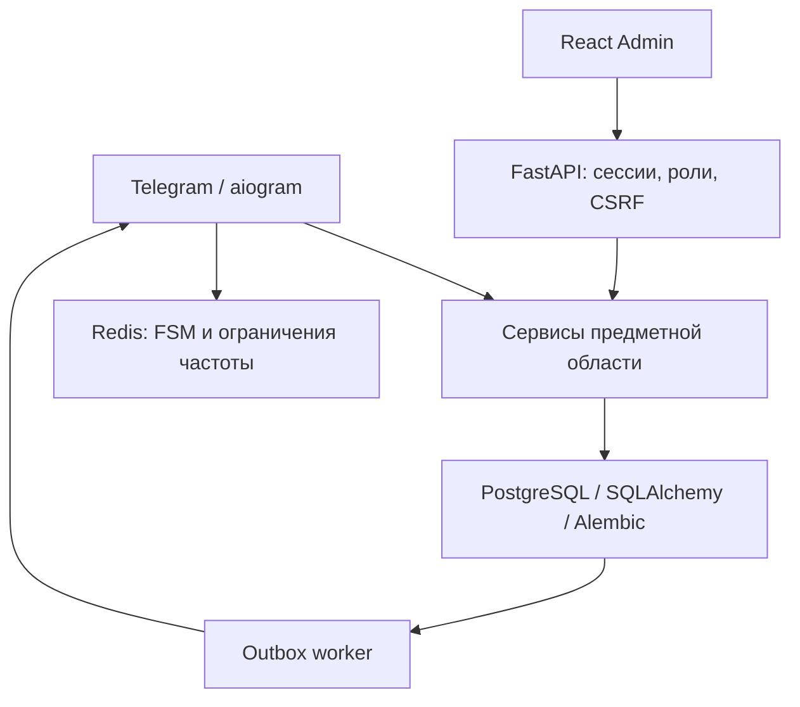

# RAUNDO

Telegram-платформа для стартапов, инвесторов, фондов и организаций с отдельной веб-админкой.

[](https://github.com/judogaaa/raundo-platform/actions/workflows/ci.yml)



## Что реализовано

| Направление | Возможности |
|---|---|
| Анкеты | Стартапы, частные инвесторы, фонды и организации; черновик, редактирование, отправка на проверку |
| Каталог | Все статусы анкет в админке, поиск, фильтры, карточки, детали и пагинация |
| Модерация | Одобрение, запрос изменений, отклонение, история и проверка прав на сервере |
| Знакомства | Лента, реакции, избранное, запрос на контакт и отдельное согласие на раскрытие контактов |
| Поддержка | Обращение, переписка, вложения, ответ сотрудника и подтверждение решения пользователем |
| Подписки | Серверный каталог Premium, Telegram Stars и адаптер ЮKassa; демо по умолчанию |
| Администрирование | Роли, сессии, TOTP, журнал действий, аналитика и доставка уведомлений через outbox |



Все опубликованные снимки сделаны с тестовыми данными. Они не показывают реальных пользователей, обращения или платёжные операции.

## Архитектура



Python 3.12+, aiogram 3, FastAPI, SQLAlchemy Async, PostgreSQL, Redis. Веб-админка: React, TypeScript, Vite. Платёж подтверждается сервером; переход на страницу успеха не выдаёт подписку.

## Локальный запуск

Нужны Python 3.12, Node.js 22, Docker Compose и **отдельный тестовый Telegram-бот**. Для сборки интерфейса и unit-тестов токен не нужен.

```bash
python -m venv .venv
# Linux/macOS: source .venv/bin/activate
# Windows PowerShell: .venv\Scripts\Activate.ps1
python -m pip install -e ".[dev]"
# Скопируйте .env.example в .env и задайте токен своего тестового бота.
docker compose -p raundo_portfolio -f infra/docker-compose.yml up -d
alembic upgrade head
python -m uvicorn raundo.admin_api.app:app --host 127.0.0.1 --port 8090
```

В другом терминале с активированной `.venv`: `raundo-bot`. Для доставки ответов поддержки и уведомлений запустите `python scripts/run-outbox-worker.py`.

```bash
cd admin-web
npm ci
npm run dev
```

Панель: `http://127.0.0.1:3000`, API: `http://127.0.0.1:8090`. Создание первого локального администратора: [DEVELOPMENT.md](docs/DEVELOPMENT.md). Сам по себе frontend без API не является работающей админкой.

## Проверки

```bash
ruff check .
pytest -q
cd admin-web
npm run build
npm run lint
npm run e2e
```

Интеграционные тесты запускаются на отдельной БД `raundo_local_suite`, браузерные — только на `raundo_admin_dev`. [Порядок проверок и результаты](docs/VALIDATION.md). GitHub Actions выполняет миграции, Python-тесты, сборку и Playwright в изолированном окружении.

## Платежи и данные

Ссылки бота на документы используют `CHECKOUT_BASE_URL`. Для собственного тестового бота задайте доступный HTTPS-адрес своей изолированной копии; локальный адрес из примера предназначен для разработки.

Публичная копия использует `PAYMENTS_MODE=demo`: платёжные ключи и реквизиты продавца пусты, юридическая готовность не подтверждена. Документы в `legal/` — **новые демонстрационные шаблоны**, а не документы владельца сервиса. Реальные платежи, чеки и работа Telegram UI с вашим ботом требуют отдельной проверки и настройки. Публикация исходников не является разрешением подключить боевую базу.

## Документация

[Архитектура](docs/ARCHITECTURE.md) · [Анкеты и проверка](docs/PROFILES_VERIFICATION.md) · [Поддержка](docs/ADMIN_SUPPORT.md) · [Веб-админка](docs/ADMIN_WEB.md) · [Безопасность](SECURITY.md) · [Сторонние материалы](THIRD_PARTY.md)

Исходники опубликованы отдельно от рабочего сервиса, без прежней Git-истории и конфигурации VPS. Условия изучения и оценки: [LICENSE](LICENSE). Существующая лицензия source-available сохранена; свободное коммерческое использование всего продукта не предоставляется.
